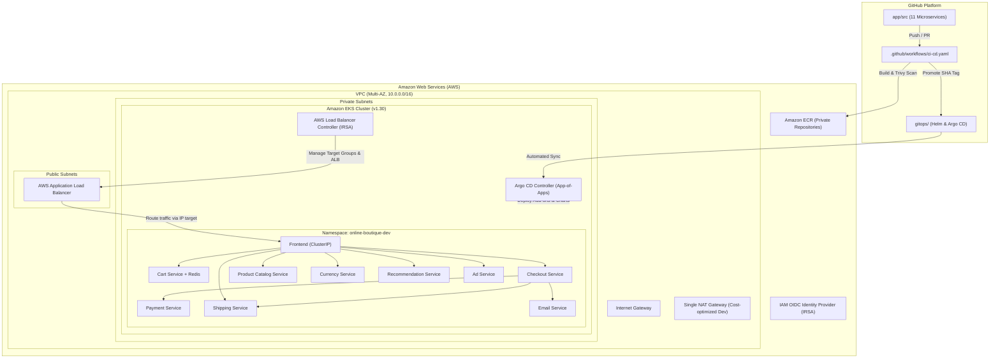

# Online Boutique on Amazon EKS: GitOps & Terraform Platform

A production-grade, GitOps-ready platform foundation deploying Google's 11-tier microservice demo ([Online Boutique](https://github.com/GoogleCloudPlatform/microservices-demo)) onto **Amazon EKS** using **Terraform**, **AWS Load Balancer Controller (ALB)**, **Argo CD**, and **GitHub Actions CI/CD**.

---

## 🏛️ Architecture Overview

The platform is designed around GitOps principles and infrastructure as code, separating application development from deployment manifests and cloud infrastructure.



---

## 📂 Repository Structure

The repository is logically structured to support either a unified monorepo or an effortless split into `app-repo` and `gitops-infra-repo`:

```text
.
├── app/                                 # Application source & local development
│   ├── docker-compose.yml               # Complete 11-service local stack
│   └── src/                             # Source code of all 11 microservices
│       ├── adservice/                   # Java
│       ├── cartservice/                 # C# (.NET)
│       ├── checkoutservice/             # Go
│       ├── currencyservice/             # Node.js
│       ├── emailservice/                # Python
│       ├── frontend/                    # Go
│       ├── loadgenerator/               # Python / Locust
│       ├── paymentservice/              # Node.js
│       ├── productcatalogservice/       # Go
│       ├── recommendationservice/       # Python
│       └── shippingservice/             # Go
├── gitops/                              # GitOps manifests & configurations
│   ├── argocd/                          # Argo CD Application manifests
│   │   ├── app-of-apps.yaml             # Root Application orchestrator
│   │   ├── add-ons/                     # Cluster core add-ons
│   │   │   ├── aws-load-balancer-controller.yaml
│   │   │   ├── external-secrets-operator.yaml
│   │   │   └── kube-prometheus-stack.yaml
│   │   └── apps/                        # Application releases
│   │       ├── online-boutique-dev.yaml
│   │       └── online-boutique-prod.yaml
│   ├── environments/                    # Environment overlays
│   │   ├── dev/                         # Dev overlay & namespace
│   │   └── prod/                        # Prod overlay & namespace
│   ├── helm-chart/                      # Customized Helm chart
│   │   ├── templates/                   # Kubernetes templates (including ALB Ingress)
│   │   ├── values.yaml                  # Base values
│   │   ├── values-dev.yaml              # Dev values (no classic ELB, right-sized CPU/mem)
│   │   └── values-prod.yaml             # Prod values (HA, scaling, loadgenerator enabled)
│   └── manifests/                       # Raw Kubernetes YAML manifests
├── terraform/                           # Modular AWS Infrastructure as Code
│   ├── versions.tf                      # Providers & version constraints
│   ├── variables.tf                     # Configurable inputs
│   ├── vpc.tf                           # Multi-AZ VPC + Subnet tagging for ALB
│   ├── eks.tf                           # Managed EKS cluster + Managed Node Group
│   ├── ecr.tf                           # Private ECR repos + lifecycle policies
│   ├── iam.tf                           # IRSA Roles (ALB Controller & ExternalDNS)
│   └── outputs.tf                       # Essential resource outputs & commands
└── .github/workflows/
    └── ci-cd.yaml                       # Automated build, Trivy scan, ECR push & GitOps tag update
```

---

## 💻 Local Verification (Docker Compose)

Before deploying to the cloud, you can run and verify the entire Online Boutique stack locally using Docker Compose:

```bash
# Navigate to the app directory
cd app

# Start the full 11-service stack + Redis cart database
docker compose up -d

# Check running service health
docker compose ps

# Access the frontend web interface
curl -I http://localhost:8080
# Or open http://localhost:8080 in your browser

# Stop and clean up
docker compose down
```

---

## 🚀 Step-by-Step AWS Deployment

### Prerequisites

- [AWS CLI v2](https://docs.aws.amazon.com/cli/latest/userguide/install-cliv2.html) configured (`aws configure`)
- [Terraform >= 1.5](https://www.terraform.io/downloads.html)
- [kubectl](https://kubernetes.io/docs/tasks/tools/)
- [Helm v3](https://helm.sh/docs/intro/install/)

---

### Step 1: Provision AWS Infrastructure with Terraform

1. **Initialize and inspect Terraform:**
   ```bash
   cd terraform
   terraform init
   terraform validate
   terraform plan -out=tfplan
   ```

2. **Apply the configuration:**
   ```bash
   terraform apply tfplan
   ```

3. **Configure local kubectl access:**
   ```bash
   aws eks update-kubeconfig --region us-east-1 --name online-boutique-eks
   kubectl get nodes
   ```

---

### Step 2: Bootstrap Argo CD

1. **Install Argo CD in the cluster:**
   ```bash
   kubectl create namespace argocd
   kubectl apply -n argocd -f https://raw.githubusercontent.com/argoproj/argo-cd/stable/manifests/install.yaml
   
   # Wait for Argo CD server to become ready
   kubectl rollout status deployment/argocd-server -n argocd --timeout=180s
   ```

2. **Retrieve the initial admin password:**
   ```bash
   kubectl -n argocd get secret argocd-initial-admin-secret -o jsonpath="{.data.password}" | base64 -d
   ```

3. **Access the Argo CD Web UI (Optional Port Forward):**
   ```bash
   kubectl port-forward svc/argocd-server -n argocd 8080:443
   # Open https://localhost:8080 (User: admin)
   ```

---

### Step 3: Configure Placeholders & Deploy App-of-Apps

1. **Update Placeholders in `gitops/argocd/`:**
   Retrieve the output variables from Terraform:
   ```bash
   cd terraform
   terraform output load_balancer_controller_role_arn
   terraform output vpc_id
   ```

   Replace placeholders in `gitops/argocd/`:
   - Replace `<AWS_LOAD_BALANCER_CONTROLLER_ROLE_ARN>` in `gitops/argocd/add-ons/aws-load-balancer-controller.yaml`
   - Replace `<AWS_VPC_ID>` with your VPC ID
   - Replace `<YOUR_GITHUB_ORG_OR_USER>` with your GitHub repository URL

2. **Apply the root App-of-Apps manifest:**
   ```bash
   kubectl apply -f gitops/argocd/app-of-apps.yaml
   ```

3. **Verify GitOps synchronization:**
   Argo CD will automatically sync:
   - **Cluster Add-ons**: AWS Load Balancer Controller, External Secrets, Kube-Prometheus-Stack
   - **Online Boutique Dev**: Deployed to `online-boutique-dev` namespace with ALB Ingress
   - **Online Boutique Prod**: Deployed to `online-boutique-prod` namespace

   ```bash
   # Inspect application status
   kubectl get applications -n argocd

   # Inspect Dev pods
   kubectl get pods -n online-boutique-dev

   # Check AWS ALB Ingress creation
   kubectl get ingress -n online-boutique-dev
   ```

---

## ⚙️ Helm Chart EKS Customizations

The Helm chart in `gitops/helm-chart/` has been customized for AWS production readiness:

| Feature | Base Upstream | Amazon EKS Customization |
| :--- | :--- | :--- |
| **Ingress Controller** | Classic ELB / None | **AWS ALB Ingress** (`ingressClassName: alb`, IP mode) |
| **Frontend Service** | `LoadBalancer` (Classic ELB) | `frontend.externalService: false` (Internal ClusterIP) |
| **Worker Sizing (Dev)** | Unconstrained / High | **~600m CPU total** (Fits 2 `t3.medium` / `t3.large` nodes) |
| **Load Generator (Dev)** | Always enabled | `loadGenerator.enabled: false` (Saves CPU in dev) |
| **Load Generator (Prod)**| Always enabled | `loadGenerator.enabled: true` (Toggleable on demand) |

---

## 🔄 CI/CD Pipeline & Continuous Delivery

The GitHub Actions workflow (`.github/workflows/ci-cd.yaml`) automates the deployment lifecycle:

1. **Selective Build**: Detects changes only within `app/src/<service>` to avoid rebuilding unchanged microservices.
2. **Keyless AWS Authentication**: Uses GitHub OIDC to assume an AWS IAM role (`role-to-assume: ${{ secrets.AWS_ROLE_ARN }}`).
3. **Security Vulnerability Scanning**: Scans newly built container images using **Aqua Trivy** for CVEs before push.
4. **Push to Amazon ECR**: Pushes immutable commit-tagged (`${{ github.sha }}`) and `latest` images to ECR.
5. **Automated GitOps Tag Promotion**: Commits the new `${{ github.sha }}` tag directly to `gitops/helm-chart/values-dev.yaml`.
6. **Automated Argo CD Sync**: Argo CD detects the updated Git commit and performs an in-place rolling update on Amazon EKS.

---

## 🧹 Teardown & Clean-up

To avoid unnecessary AWS cloud costs:

```bash
# 1. Delete Argo CD root app-of-apps (cascading deletes Ingress & ALBs)
kubectl delete -f gitops/argocd/app-of-apps.yaml

# 2. Wait 2 minutes for AWS ALB to be dismantled by AWS Load Balancer Controller
sleep 120

# 3. Destroy Terraform infrastructure
cd terraform
terraform destroy -auto-approve
```
